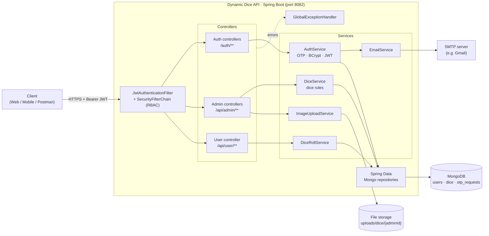

# Dynamic Dice API

[](https://github.com/yuviyashu/dynamic_dice/actions/workflows/ci.yml)

A secure, role-based REST API for creating and rolling **custom dice** — built with Java 21, Spring Boot 3, Spring Security (stateless JWT) and MongoDB.

Admins design dice with six image-backed faces; users onboard under an admin through an **admin-approved, email-OTP registration flow**, then roll that admin's dice. The service is frontend-agnostic and can sit behind any web or mobile client.

---

## Table of contents

- [Highlights](#highlights)
- [Architecture](#architecture)
- [Authentication flow](#authentication-flow)
- [Tech stack](#tech-stack)
- [Getting started](#getting-started)
- [Configuration](#configuration)
- [API reference](#api-reference)
- [Testing](#testing)
- [Project structure](#project-structure)
- [Roadmap](#roadmap)
- [License](#license)

---

## Highlights

- **Stateless JWT security** — HS256-signed tokens carrying `userId`, `role` and `adminId` claims; no server-side sessions.
- **Role-based access control** — `ADMIN` and `USER` roles enforced in the Spring Security filter chain (`/api/admin/**`, `/api/user/**`); tenant scope (which admin's dice you can see or roll) is derived from the signed token, never from client headers.
- **Correct auth semantics** — missing, malformed or expired tokens return `401`; a valid token with the wrong role returns `403`.
- **Admin-approved onboarding** — a user's registration OTP is emailed to *their admin*, so admins gate who joins their workspace.
- **OTP lifecycle** — 6-digit, single-use codes from `SecureRandom` with a 5-minute expiry, persisted in MongoDB.
- **Domain rules in the service layer** — exactly 6 faces per die, every face needs a value and an image, max 3 dice per admin.
- **Image upload** — admins upload face images (≤ 5 MB, `image/*` only), stored per admin and served under `/uploads/**`.
- **Consistent error contract** — a global `@RestControllerAdvice` maps exceptions to a uniform JSON error body.
- **Container-ready** — multi-stage Dockerfile and a Docker Compose stack with MongoDB.
- **CI** — GitHub Actions builds, runs the test suite with JaCoCo coverage, and verifies the Docker image on every push and pull request.

## Architecture

A single Spring Boot service with a classic layered design: controllers → services → Spring Data repositories → MongoDB.



### Data model

| Collection       | Purpose                                                                 |
|------------------|-------------------------------------------------------------------------|
| `users`          | Admins and users. `username` = email, BCrypt password, `role`, and `adminId` for users. |
| `dice`           | A die owned by an admin: name, status and exactly six `{value, imageUrl}` faces. |
| `otp_requests`   | OTP code, purpose (`ADMIN_REGISTRATION` / `USER_REGISTRATION`), expiry, used flag, metadata. |
| `dice_roll_logs` | Roll audit model (repository in place; persistence planned — see [Roadmap](#roadmap)). |

## Authentication flow

```mermaid
sequenceDiagram
    autonumber
    actor A as Admin
    actor U as User
    participant API as Dynamic Dice API
    participant DB as MongoDB
    participant M as SMTP

    rect rgb(240,245,255)
    note over A,M: Admin registration
    A->>API: POST /auth/admin/register/request-otp {email}
    API->>DB: save OTP (5-min expiry)
    API->>M: email OTP to admin
    A->>API: POST /auth/admin/register/verify-otp {email, otp, password}
    API->>DB: validate OTP, create ADMIN (BCrypt), mark OTP used
    end

    rect rgb(240,255,245)
    note over U,M: User registration (approved by admin)
    U->>API: POST /auth/user/register/request-otp {userEmail, adminEmail}
    API->>M: email OTP to the ADMIN
    A-->>U: shares OTP out-of-band (approval)
    U->>API: POST /auth/user/register/verify-otp {adminEmail, otp, userPassword}
    API->>DB: create USER linked to adminId
    end

    rect rgb(255,248,240)
    note over U,API: Login and authorised calls
    U->>API: POST /auth/login {email, password}
    API-->>U: JWT (sub=userId, role, adminId; 1h expiry)
    U->>API: POST /api/user/dice/roll/{diceId} + Authorization: Bearer JWT
    API->>API: JwtAuthenticationFilter verifies signature, sets ROLE_USER
    API-->>U: {rolledValue, imageUrl}
    end
```

## Tech stack

| Area            | Technology                                                    |
|-----------------|---------------------------------------------------------------|
| Language        | Java 21                                                       |
| Framework       | Spring Boot 3.2 (Web MVC, Validation, Actuator, Mail)         |
| Security        | Spring Security 6, JJWT 0.11 (HS256), BCrypt                  |
| Persistence     | MongoDB 6, Spring Data MongoDB                                |
| API docs        | springdoc-openapi (OpenAPI 3 + Swagger UI)                    |
| Build           | Gradle 8.5 (wrapper included)                                 |
| Containers      | Docker (multi-stage build), Docker Compose                    |
| Productivity    | Lombok                                                        |
| Testing         | JUnit 5, Spring Boot Test                                     |

## Getting started

### Prerequisites

- **Docker** + Docker Compose v2 — for the one-command setup, **or**
- **JDK 21** and a running **MongoDB 6+** — for running from source
- An SMTP account for OTP emails (for Gmail, create an [App Password](https://support.google.com/accounts/answer/185833))

### 1. Generate a JWT signing key

The signing key is never committed. Generate a Base64 key of at least 32 bytes:

```bash
export JWT_SECRET=$(openssl rand -base64 32)
```

### 2a. Run with Docker Compose (recommended)

```bash
git clone https://github.com/yuviyashu/dynamic_dice.git
cd dynamic_dice

cp .env.example .env      # then fill in JWT_SECRET and the SMTP credentials
docker compose up --build
```

Docker Compose reads `.env` automatically; it is git-ignored so secrets stay on your machine. Exporting the same variables in your shell works too.

This starts MongoDB (`localhost:27017`) and the API (`localhost:8082`). Uploaded images are persisted to `./uploads`.

### 2b. Run from source

```bash
# Start MongoDB
docker run -d --name mongo -p 27017:27017 mongo:6.0

# Run the app with the local profile (points at localhost MongoDB)
export JWT_SECRET=$(openssl rand -base64 32)
export SPRING_MAIL_USERNAME=you@gmail.com
export SPRING_MAIL_PASSWORD='your-app-password'
SPRING_PROFILES_ACTIVE=local ./gradlew bootRun
```

### 3. Verify

```bash
curl http://localhost:8082/actuator/health
# {"status":"UP"}
```

## Configuration

All settings live in `src/main/resources/application.yaml` and can be overridden with environment variables (Spring relaxed binding).

| Property                         | Env variable                     | Default                               | Description                              |
|----------------------------------|----------------------------------|---------------------------------------|------------------------------------------|
| `server.port`                    | `SERVER_PORT`                    | `8082`                                | HTTP port                                |
| `spring.data.mongodb.uri`        | `SPRING_DATA_MONGODB_URI`        | `mongodb://mongo:27017/dynamicdice`   | MongoDB connection string                |
| `jwt.secret`                     | `JWT_SECRET`                     | — (**required**)                      | Base64 HMAC key, ≥ 32 bytes              |
| `jwt.expiration-ms`              | `JWT_EXPIRATION_MS`              | `3600000` (1 h)                       | Token lifetime                           |
| `spring.mail.username`           | `SPRING_MAIL_USERNAME`           | —                                     | SMTP username                            |
| `spring.mail.password`           | `SPRING_MAIL_PASSWORD`           | —                                     | SMTP password / app password             |
| `file.upload-dir`                | `FILE_UPLOAD_DIR`                | `uploads/dice`                        | Image storage directory                  |
| `spring.servlet.multipart.max-file-size` | —                        | `5MB`                                 | Max upload size per file                 |

Profiles: `default` targets the Compose network (`mongo` host); `local` targets `localhost`.

## API reference

Interactive documentation (Swagger UI) is available once the app is running:

- **Swagger UI:** http://localhost:8082/swagger-ui/index.html
- **OpenAPI JSON:** http://localhost:8082/v3/api-docs

| Method | Endpoint                               | Auth   | Description                                         |
|--------|----------------------------------------|--------|-----------------------------------------------------|
| POST   | `/auth/admin/register/request-otp`     | Public | Send a registration OTP to an admin email           |
| POST   | `/auth/admin/register/verify-otp`      | Public | Verify OTP and create the admin account             |
| POST   | `/auth/user/register/request-otp`      | Public | Request user registration; OTP goes to the admin    |
| POST   | `/auth/user/register/verify-otp`       | Public | Verify the admin-approved OTP and create the user   |
| POST   | `/auth/login`                          | Public | Exchange credentials for a JWT                      |
| POST   | `/api/admin/images/upload`             | ADMIN  | Upload a face image (multipart `file`) → `imageUrl` |
| POST   | `/api/admin/dice`                      | ADMIN  | Create a die with exactly six faces                 |
| GET    | `/api/admin/dice`                      | ADMIN  | List the calling admin's dice                       |
| GET    | `/api/user/dice`                       | USER   | List the dice of the user's admin                   |
| POST   | `/api/user/dice/roll/{diceId}`         | USER   | Roll one of your admin's dice → `{rolledValue, imageUrl}` |
| GET    | `/actuator/health`                     | Public | Liveness / health check                             |

### Example: end-to-end with curl

```bash
# Login
TOKEN=$(curl -s -X POST localhost:8082/auth/login \
  -H 'Content-Type: application/json' \
  -d '{"email":"admin@example.com","password":"S3cure!pass"}' | jq -r .token)

# Upload a face image
curl -X POST localhost:8082/api/admin/images/upload \
  -H "Authorization: Bearer $TOKEN" -F file=@face1.png
# {"imageUrl":"/uploads/dice/<adminId>/<uuid>.png"}

# Create a die
curl -X POST localhost:8082/api/admin/dice \
  -H "Authorization: Bearer $TOKEN" -H 'Content-Type: application/json' \
  -d '{"diceName":"Classic","faces":[
        {"value":"1","imageUrl":"/uploads/dice/a/1.png"},
        {"value":"2","imageUrl":"/uploads/dice/a/2.png"},
        {"value":"3","imageUrl":"/uploads/dice/a/3.png"},
        {"value":"4","imageUrl":"/uploads/dice/a/4.png"},
        {"value":"5","imageUrl":"/uploads/dice/a/5.png"},
        {"value":"6","imageUrl":"/uploads/dice/a/6.png"}]}'
```

### Error format

```json
{
  "message": "Dice must contain exactly 6 faces",
  "status": 400,
  "timestamp": "2026-01-01T10:00:00Z",
  "path": "/api/admin/dice"
}
```

### Business rules

- An admin can own at most **3** dice.
- A die must have exactly **6** faces; each face needs a value and an image.
- OTPs are 6 digits, single-use, and expire after **5 minutes**.
- Image uploads must be `image/*` and ≤ **5 MB**.

## Testing

```bash
./gradlew test
```

No external services are needed: tests run under the `test` profile with a throwaway signing key.

| Suite                              | Type                | What it covers                                                       |
|------------------------------------|---------------------|----------------------------------------------------------------------|
| `DiceServiceImplTest`              | Unit (Mockito)      | 6-face rule, image required, max 3 dice per admin, admin scoping     |
| `DiceRollServiceImplTest`          | Unit (Mockito)      | Roll result, cross-admin roll blocked, unknown die → 404             |
| `JwtUtilTest`                      | Unit                | Claims round-trip, foreign-key and expired tokens rejected           |
| `OtpUtilTest`                      | Unit                | OTP format                                                           |
| `UserDiceControllerSecurityTest`   | Web slice (MockMvc) | 401 / 403 behaviour, scope taken from JWT not headers                |
| `DiceApplicationTests`             | Context             | Application context starts                                           |

Reports:

- Tests: `build/reports/tests/test/index.html`
- Coverage (JaCoCo): `build/reports/jacoco/test/html/index.html`

## Project structure

```
src/main/java/com/dynamic/dice
├── configuration/   # Security filter chain, password encoder, MongoDB, static resources
├── controller/      # REST endpoints (auth, admin, user, image upload)
├── dto/             # Request / response payloads
├── enums/           # Role
├── exception/       # Domain exceptions
├── filter/          # JwtAuthenticationFilter
├── handler/         # GlobalExceptionHandler (uniform error contract)
├── model/           # MongoDB documents
├── repository/      # Spring Data repositories
├── service/         # Service interfaces + implementations
└── utils/           # JwtUtil, OtpUtil
```

## Roadmap

- [x] Unit and web-slice tests with JaCoCo coverage report
- [x] GitHub Actions CI: build, test, coverage, container image
- [x] Derive admin scope from the JWT instead of client headers
- [ ] Integration tests against real MongoDB (Testcontainers) and a coverage gate
- [ ] Bean Validation (`@Valid`) on all request DTOs
- [ ] OTP hardening: attempt limits, rate limiting, TTL index
- [ ] Persist roll history (`dice_roll_logs`) and expose a history endpoint
- [ ] Object storage (S3-compatible) for images

## License

Distributed under the MIT License. See [LICENSE](LICENSE).
